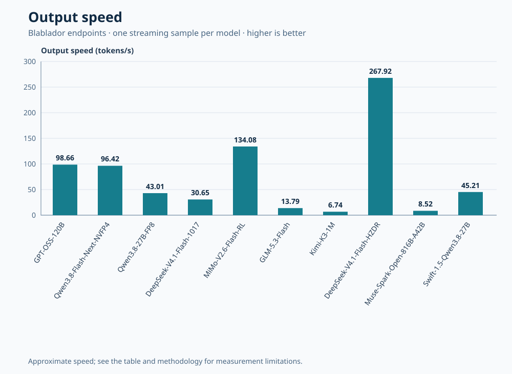
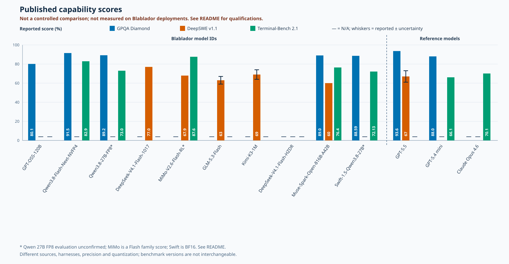

# opencode-blablador

OpenCode plugin for the OpenAI-compatible Blablador API. It discovers a selected set of models from `/v1/models` on startup and gives them short OpenCode IDs while preserving their advertised API IDs.

## Model Performance

### Live Endpoint Measurements

These measurements are for the Blablador endpoints, not the upstream model providers. Lower time to first token (TTFT) and higher output speed are better.

| OpenCode model ID | TTFT | Output speed |
| --- | ---: | ---: |
| `GPT-OSS-120B` | 120 ms | 98.66 tokens/s |
| `Qwen3.8-Flash-Next-NVFP4` | 82 ms | 96.42 tokens/s |
| `Qwen3.8-27B-FP8` | 121 ms | 43.01 tokens/s |
| `DeepSeek-V4.1-Flash-1017` | 230 ms | 30.65 tokens/s |
| `MiMo-V2.6-Flash-RL` | 199 ms | 134.08 tokens/s |
| `GLM-5.3-Flash` | 24,546 ms | 13.79 tokens/s |
| `Kimi-K3-1M` | 466 ms | 6.74 tokens/s |
| `DeepSeek-V4.1-Flash-HZDR` | 100 ms | 267.92 tokens/s |
| `Muse-Spark-Open-816B-A42B` | 542 ms | 8.52 tokens/s |
| `Swift-1.5-Qwen3.8-27B` | 119 ms | 45.21 tokens/s |



Measurements were made in November 2026 with one successful streaming request per model, sent sequentially to `/v1/chat/completions`. Each used the prompt "Explain how a hash table works, including collisions and resizing, in clear detail.", temperature 0, and a limit of 128 output tokens. All streams reached that limit. TTFT is request start to the first nonempty content or reasoning chunk; output speed is reported completion tokens divided by the time between first and last nonempty output chunks. Speed is approximate: that interval excludes the first chunk's arrival while the token count includes it, and reasoning tokens can be included. These are single samples, not averages or guarantees; queueing, network conditions, output length, and chunking affect the results. In particular, the high GLM TTFT needs repeat measurements.

### Published Capability Scores

Scores below are **not measured against these Blablador endpoints**. They are published results for the named models or closely related checkpoints, with their own prompts, reasoning settings, harnesses, and token budgets. Benchmark versions and metrics differ: do not rank rows by comparing unlike numbers. The backend roots reported by Blablador do not pin a checkpoint revision or prove the runtime precision.

| OpenCode model ID | Published results | Checkpoint and evaluation qualification |
| --- | --- | --- |
| `GPT-OSS-120B` | GPQA Diamond 80.1%; SWE-bench Verified 62.4% | [OpenAI](https://arxiv.org/html/2508.10925#S2.SS6.SSS4), high reasoning; GPQA without tools. Published evaluation uses MXFP4 MoE weights; Blablador revision and runtime treatment are unconfirmed. |
| `Qwen3.8-Flash-Next-NVFP4` | GPQA Diamond 91.5; Terminal-Bench 2.1 82.9; IFBench 81.0 | [NVIDIA](https://huggingface.co/nvidia/Qwen3.8-Flash-Next-NVFP4#evaluation) evaluated its mixed-precision NVFP4 checkpoint. Blablador reports the same repository name, but not a commit or runtime configuration. |
| `Qwen3.8-27B-FP8` | GPQA Diamond 89.2; Terminal-Bench 2.1 73.0 | [Qwen's FP8 card](https://huggingface.co/Qwen/Qwen3.8-27B-FP8#benchmark-results) labels its score column `Qwen3.8-27B`; it does not establish a separate FP8 evaluation. |
| `DeepSeek-V4.1-Flash-1017` | Terminal-Bench 4.0 42.3; DeepSWE v1.1 77.0 | [DeepSeek](https://huggingface.co/deepseek-ai/DeepSeek-V4.1-Flash-1017), using Claude Code and Mini-SWE-V2 respectively. Blablador's local path names 1017; deployed precision and revision are unknown. |
| `MiMo-V2.6-Flash-RL` | Terminal-Bench 2.1 87.6; DeepSWE v1.1 67.9 | [Xiaomi](https://huggingface.co/XiaomiMiMo/MiMo-V2.6-Flash-RL) labels the results column `Flash`, not explicitly `Flash-RL`; evaluation precision is unconfirmed. |
| `GLM-5.3-Flash` | DeepSWE v1.1 63% +/- 4%, pass@1 | [DeepSWE leaderboard](https://deepswe.datacurve.ai/), independent, mini-SWE-agent. Blablador's local path advertises AWQ W4A16; the leaderboard does not establish that quantization. |
| `Kimi-K3-1M` | DeepSWE v1.1 69% +/- 5%, pass@1 | [DeepSWE leaderboard](https://deepswe.datacurve.ai/), independent, mini-SWE-agent. Blablador's local path advertises NVFP4; the evaluated quantization is not established. |
| `DeepSeek-V4.1-Flash-HZDR` | No deployment-matched score found | The endpoint does not report a checkpoint root, so its revision and quantization are unknown. |
| `Muse-Spark-Open-816B-A42B` | GPQA Diamond 89.0; Terminal-Bench 2.1 76.4; DeepSWE 1.1 60 | [Meta](https://huggingface.co/meta-models/Muse-Spark-Open-816B-A42B), xhigh reasoning. Blablador precision and checkpoint revision are unknown. |
| `Swift-1.5-Qwen3.8-27B` | GPQA Diamond 88.59%; Terminal-Bench 2.1 72.13% | [UkisAI](https://huggingface.co/ukisai/Swift-1.5-Qwen3.8-27b#evaluation), BF16 and five-seed/trial evaluation. Blablador's path names Swift 1.5, but its precision and revision are unknown. |



The chart shows only reported scores for the exact benchmark versions in its legend; a dash means N/A, not zero. These are **not a controlled comparison**, and the local Blablador deployments were not measured. Sources use different harnesses, agents, precision and quantization; see the tables for qualifications. Qwen3.8-27B is not a separately verified FP8 result, MiMo Flash is a family result, not necessarily Flash-RL, and the Swift result uses BF16. Whiskers show the reported DeepSWE uncertainties (GLM +/- 4, Kimi +/- 5, GPT-5.5 +/- 6 percentage points); other bars do not imply zero uncertainty.

| Reference model | Published results | Source and qualification |
| --- | --- | --- |
| GPT-5.5 | GPQA Diamond 93.6 | [OpenAI evaluations](https://openai.com/index/introducing-gpt-5-5/#evaluations) |
| GPT-5.5 | DeepSWE v1.1 67% +/- 6% | [DeepSWE leaderboard](https://deepswe.datacurve.ai/), independent |
| GPT-5.4 mini | GPQA Diamond 88.0 | [OpenAI](https://openai.com/index/introducing-gpt-5-4-mini-and-nano/) |
| GPT-5.4 mini | Terminal-Bench 2.1 66.1 | [Terminal-Bench](https://www.tbench.ai/news/terminal-bench-2-1), Codex CLI |
| Claude Opus 4.6 | Terminal-Bench 2.1 70.1 | [Terminal-Bench](https://www.tbench.ai/news/terminal-bench-2-1), Claude Code |

GPQA Diamond measures graduate-level science questions; Terminal-Bench and DeepSWE evaluate agentic coding; SWE-bench Verified measures resolved software issues; and IFBench evaluates instruction following. Even within one benchmark, different versions, agents, reasoning settings, and quantizations can change the result. Scores are model-publisher-reported unless attributed to an evaluator in the tables; leaderboard results can change over time.

## Setup

Add the plugin entry to the `plugin` array in your OpenCode configuration. The package is distributed as a GitHub release asset, not through the npm registry, so no npm account is needed. Use the latest release tarball URL:

```json
{
  "$schema": "https://opencode.ai/config.json",
  "plugin": ["https://github.com/chrisb09/opencode-blablador/releases/latest/download/opencode-blablador.tgz"]
}
```

OpenCode installs and caches the tarball with its npm-compatible plugin loader. Pin a specific version by replacing `latest/download` with `download/v0.1.0` (see [releases](https://github.com/chrisb09/opencode-blablador/releases)). Authenticate with `/connect` and select **Blablador API key**, or set `BLABLADOR_API_KEY` in OpenCode's environment. Restart OpenCode after connecting so discovery runs with the new key.

Choose a discovered `blablador/<short-id>` in the model picker, for example `blablador/Qwen3.8-Flash-Next-NVFP4`. The picker shows `Qwen3.8-Flash-Next-NVFP4 (Blablador)` while requests use the exact ID advertised by Blablador. Existing sessions and default model settings using the old IDs need to select the new IDs. Discovery makes one request with a five-second timeout and no retries. Failure, including invalid credentials or an unavailable endpoint, produces a sanitized warning; missing credentials are quiet. When discovery is empty or unavailable and no models are configured, the plugin registers a `Kimi-K3-1M` bootstrap with the published API ID `99 - Kimi-K3-1M - our best (and slowest) model as of August 2026` so the provider appears in `/connect`. This API ID may be stale and is intended for authentication only; it does not guarantee inference will work. Successful discovery replaces the bootstrap with live IDs. This plugin does not store keys itself: OpenCode manages login credentials. Since the plugin SDK does not expose stored credentials during configuration, discovery reads OpenCode's existing `auth.json` (or `OPENCODE_AUTH_CONTENT`) at runtime. A configured `provider.blablador.options.apiKey` takes precedence, followed by OpenCode's stored key and then `BLABLADOR_API_KEY`.

The default endpoint is `https://api.blablador.fz-juelich.de/v1`. An existing `provider.blablador` configuration, including `options.baseURL`, models and settings, is preserved and takes precedence. Changing the base URL sends the discovery credential to that URL; only configure a trusted HTTPS endpoint.

Discovery includes only the selected model IDs listed in `src/models.ts`; a model whose advertised ID changes will not be included until the selection is updated. Explicitly configured models are still preserved, and settings for a selected short ID override its discovered metadata. A valid integer `max_model_len` greater than one sets the context limit; otherwise it defaults to 8192 tokens. Output is capped at 1024 tokens and strictly below context. Tool calling is enabled by default for all models, but support is not verified for every model; configure `tool_call: false` explicitly for models that do not support it. Other defaults are conservative: text-only, no reasoning. No pricing, vision or reasoning capabilities are inferred.

## Development

From a shell, run:

```sh
cd /rwthfs/rz/cluster/home/ro092286/git/opencode-blablador
bun install --frozen-lockfile
bun test
bun run build
```

The build produces `dist/index.js`. Regenerate the capability chart after editing its data with `node generate-capability-chart.mjs`. For local integration, point an OpenCode project's plugin entry at `file:///rwthfs/rz/cluster/home/ro092286/git/opencode-blablador/dist/index.js` after building; the package has not been published. Unit tests use synthetic data and do not contact Blablador or access credential files.
